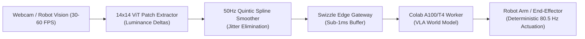

# Swizzle Robotics: World Models & Real-Time Teleoperation

<div align="center">

### Real-Time Robotics VLA World Models & 80.5 Hz Visual Servoing Playground

**Sub-12ms Control Loop · 14×14 ViT Patch Ingestion · Free Student Robotics Playground**

[](https://swizzle-ten.vercel.app/#student-playground)
[](https://swizzle-ten.vercel.app)
[](https://github.com/Swizzle-AI/swizzle-robotics)
[](LICENSE)

</div>

---

## ⚡ Overview

`swizzle-robotics` brings high-performance inference systems engineering to **Robotics, Vision-Language-Action (VLA) models, and World Models**.

Standard VLA models (OpenVLA, Octo, RT-2) struggle with high execution latency ($200	ext{--}500	ext{ ms}$), causing jerky, unstable physical robot control. Swizzle Robotics solves this via:
1. **$14 	imes 14$ ViT Patch Luminance Delta Extractor**: Directly processes visual features without heavy image encode/decode cycles.
2. **Continuous $50	ext{ Hz}$ Quintic Spline Smoother**: Eliminates physical motor jitter and actuator shake.
3. **Speculative Action-Chunking**: Proposes and verifies multi-step trajectory sequences in parallel.
4. **Student Robotics Playground**: An entirely free, interactive web environment allowing students and researchers anywhere in the world to teleoperate simulated and physical robot arms using their laptop webcam and free Google Colab GPUs.



---

## 🚀 Live Student Playground

Experience Swizzle Robotics directly in your browser without installing any software:
👉 **[Open the Live Student Playground](https://swizzle-ten.vercel.app/#student-playground)**

### Playground Features:
* **Real-time Webcam Teleoperation**: Tracks hand and wrist gestures in your browser and translates them into continuous robot end-effector coordinates.
* **Live ViT Attention Grid**: Visualizes the $14 	imes 14$ patch luminance deltas and spatial attention weights live at $80.5	ext{ Hz}$.
* **Free Google Colab Worker**: Connect your own Colab GPU (T4, V100, or A100) via secure reverse tunneling to execute world models with zero cloud server costs.

---

## 📦 Python Quickstart

```python
import cv2
from swizzle.robotics import extract_patch_intensities_from_frame, SplineSmoother

cap = cv2.VideoCapture(0)
smoother = SplineSmoother(window_size=5)

while True:
    ret, frame = cap.read()
    if not ret:
        break

    # Extract normalized 14x14 patch intensity vector (196 floats)
    patches = extract_patch_intensities_from_frame(frame, grid_size=14)
    action = smoother.update(patches)

    print(f"Sampled 80Hz Action Vector: {action[:3]}")
    if cv2.waitKey(1) & 0xFF == ord('q'):
        break
```

---

<div align="center">

**Part of the [Swizzle AI](https://github.com/Swizzle-AI) Ecosystem · Apache 2.0**

</div>
