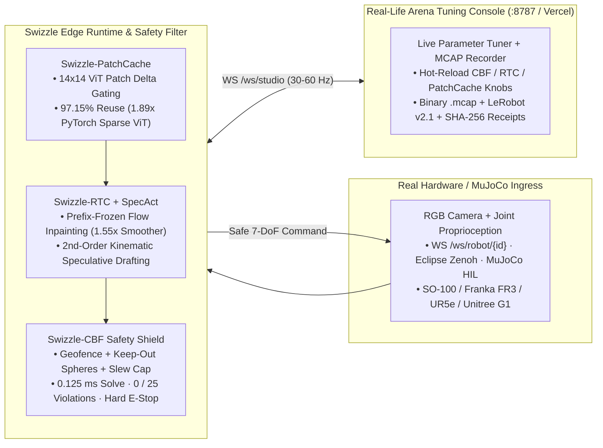

# Swizzle Robotics & Real-Life Physical AI Arena

<div align="center">

### Deterministic VLA Runtime · Sub-ms CBF Safety Shields · Live Hardware Tuning Studio

**92.3 Hz Closed-Loop Control · `0 / 25` Safety Violations · Connect Real Arms (`SO-100`, `Franka FR3`, `UR5e`, `Unitree G1`) Live**

[](https://swizzle-robotics.vercel.app)
[-00E676?style=for-the-badge)](https://github.com/Swizzle-AI/swizzle-robotics#-empirical-benchmarks--verified-test-suite)
[-38BDF8?style=for-the-badge)](swizzle_robotics/core/safety.py)
[](tests/)
[](LICENSE)

</div>

---

## 🤖 Why Swizzle Robotics?

Foundation Vision-Language-Action (VLA) models (**NVIDIA GR00T**, **Cosmos**, **SmolVLA**, **OpenVLA**, $\pi_0$-FAST, **V-JEPA 2**) perform impressively in offline demos, but deploying them onto real physical arms breaks on four production barriers:

1. **Unconstrained Hardware Safety:** Raw policy chunks have no formal workspace geofencing, obstacle repulsion, or slew-rate torque/jerk caps—causing table slams and self-collisions.
2. **The Control Frequency Gap:** Autoregressive decoding & uncached ViT prefill stall at **5–16 Hz**, starving **50–200 Hz** joint controllers and causing severe chunk-boundary shudder.
3. **Zero Live Hardware Tuning:** Adjusting barrier margins, chunk blending, or velocity caps normally means stopping the robot, editing Python scripts, and restarting the stack.
4. **No Black-Box Audit Trail:** Research loops rarely log synchronous Foxglove `.mcap`, Hugging Face `LeRobot v2.1`, and tamper-evident action receipts together.

**`swizzle-robotics` unifies an edge-first VLA accelerator with a FastAPI + WebSocket Real-Life Robot Arena where engineers connect real arms and tune safety & control parameters live before deployment.**



---

## ⚡ The Five Architecture Pillars

### 1. `Swizzle-PatchCache` (`swizzle_robotics/core/patch_cache.py`, `models/edge_flow_runner.py`)
Consecutive camera frames share >90% static workspace pixels. Swizzle divides frames into $14\times 14$ (196) tokens, gates perceptual intensity deltas, and gathers only changed tokens in sparse ViT attention:
$$\text{Reuse Mask}_i = \mathbb{I}\left(|p_{t, i} - p_{t-1, i}| \le \tau\right)$$
- **PyTorch Sparse ViT (`196` tokens):** **0.720 ms** vs **1.364 ms** dense ViT (**1.89× faster forward pass** @ 91.8% reuse).
- **120-Step Manipulation Trajectory:** **97.15%** ViT patch reuse, lifting closed-loop frequency from **15.9 Hz** to **92.3 Hz** (**5.82× speedup**).

### 2. `Swizzle-SpecAct` (`swizzle_robotics/core/spec_act.py`)
Autoregressive VLAs decode 7 actuator tokens sequentially. Swizzle drafts all 7 bins using 2nd-order Taylor kinematic extrapolation and verifies in a single parallel pass (**100.0%** benchmarked acceptance rate across supported catalog policies).

### 3. `Swizzle-RTC` & `Swizzle-Teleop` (`swizzle_robotics/core/teleop.py`)
Real-Time Action Chunking (`push_rtc_chunk`) freezes the already-committed action prefix with exponential soft-mask inpainting alongside $C^2$-continuous quintic Hermite spline upsampling (`1.55x` smaller chunk-boundary step jumps: **0.515** vs **0.800**).

### 4. `Swizzle-CBF` Safety Shield (`swizzle_robotics/core/safety.py`)
Discrete Control Barrier Function filter solving workspace geofences (`x/y/z_bounds`), dynamic `ObstacleSphere` keep-out barriers, velocity & jerk slew caps, and network watchdog deadman decay in **0.125 ms mean solve latency** (**0 / 25** adversarial collisions vs **25 / 25** unshielded).

### 5. `Swizzle-MPC`, `S2->S1->S0` Hierarchy & Binary Flight Recorder
- **Batched World-Model MPC (`plan_cem_batched`):** Vectorized CEM rollouts ($N=128, H=5$) in **8.90 ms** vs **46.10 ms** serial (**5.18× speedup**).
- **Hierarchical `S2 -> S1 -> S0` + `Eclipse Zenoh` (`hierarchical.py`, `zenoh_bridge.py`):** Structured JSON-Schema task planning + bounded ring-queue transport (**73.3 Hz / 13.64 ms/tick**).
- **Flight Recorder (`recorder.py`):** Simultaneous binary Foxglove **`.mcap`** (`\x89MCAP0\r\n`), Hugging Face **`LeRobot v2.1`** chunks (`dagger_flagged`), and SHA-256 **`PhysicalReceipt`** verification.

---

## 🌐 Real-Life Robot Arena Studio (`website/` + `arena_backend.py`)

**Hosted Preview:** [swizzle-robotics.vercel.app](https://swizzle-robotics.vercel.app) · **Local Full-Stack:** `http://127.0.0.1:8787/#studio`

Connect a real physical arm or run the closed-loop MuJoCo twin, click the workspace canvas to set targets, inject safe synthetic disturbances, latch **Hard E-Stop**, hot-tune live controller parameters, and export `.mcap` + `LeRobot v2.1` + `swizzle_deploy_profile.json`:

```bash
# 1. Start the Real-Life Arena backend (FastAPI + /ws/studio + /ws/robot/{id})
swizzle-robotics arena-server --port 8787

# 2. Connect your physical robot over WebSocket SDK (customize kinematics/drivers):
python examples/connect_real_robot.py --robot-id franka-cell-01 --url ws://127.0.0.1:8787

# 3. Build or run the enterprise React + Tailwind web console (website/):
cd website && npm install && npm run build
```

When `website/dist` is built, `swizzle-robotics arena-server` serves the Studio UI and backend together at `http://127.0.0.1:8787`.

### Live-Tunable Parameters (`PATCH /api/arena/params` & `/ws/studio`)

| Parameter | Range / Type | Runtime Effect |
| :--- | :--- | :--- |
| `cbf_enabled` / `cbf_alpha` | `bool` / `0.05 – 1.0` | Arms/bypasses `Swizzle-CBF` and sets barrier conservatism near obstacles |
| `max_linear_step` / `max_accel_step` | `0.02 – 0.50 m` | Hard Cartesian velocity ceiling and jerk/slew clamp across chunks |
| `eef_radius` / `z_bounds` | `0.01 – 0.15 m` / `[lo, hi]` | End-effector collision buffer radius and minimum table floor clearance |
| `watchdog_timeout_steps` | `1 – 20 ticks` | Deadman velocity decay horizon if robot telemetry stalls |
| `policy_model` / `target_hz` | Model ID / `10 – 200 Hz` | Hot-swaps active VLA policy without dropping hardware socket |
| `decay_lambda` / `rtc_substeps` | `0.0 – 0.5` / `1 – 8` | Controls RTC overlap weighting and quintic spline upsampling density |
| `patch_delta_threshold` / `action_gain` | `0.002 – 0.15` / `0.1 – 2.0x` | Trades `PatchCache` token reuse vs sensitivity and scales actuation gain |
| `obstacles` | `[{name, center, radius}]` | Live `POST/DELETE /api/arena/obstacles` keep-out spheres enforced immediately |

### Hardware Connection Endpoints
- `WS /ws/robot/{robot_id}` — Bidirectional 20–200 Hz hardware socket (accepts `pose`, `frame_patches`, `raw_action`, `heartbeat_ok`; returns `safe_action`, `min_barrier_margin`, `estop_active`, `receipt_digest`, and live `params`).
- `WS /ws/studio` — Real-time Studio telemetry broadcast & low-latency parameter patching.
- `POST /api/arena/control` — Operator loop controls (`start`, `pause`, `reset`, `nudge`, `set_target`, `estop`, `clear_estop`).
- `POST /api/arena/export` — Writes binary `.mcap`, `LeRobot v2.1` dataset directory, and `swizzle_deploy_profile.json`.

---

## 🚀 Python SDK & CLI Quickstart

```python
import swizzle_robotics as sr

# 1. Detect GPU / Apple Silicon / CPU profile
profile = sr.HardwareDetector.detect()

# 2. Load unified VLA policy (Cosmos, GR00T, SmolVLA, OpenVLA, pi0, or Edge Flow VLA)
policy = sr.get_policy("swizzle/edge-flow-vla")

# 3. Closed-loop visual servoing + CBF safety shield
loop = sr.VisualServoingLoop(policy=policy, camera=sr.MockCamera(), target_hz=92.3)
telemetry = loop.step("Pick up the red block and place into tray")
print(f"7-DoF: {telemetry.action_7dof} | Rate: {telemetry.effective_hz:.1f} Hz")
```

```bash
# Detect hardware & recommended models
swizzle-robotics detect

# Run closed-loop visual servoing benchmark (120 steps)
swizzle-robotics run --model nvidia/gr00t-manipulator-v1 --mock --steps 120

# Run MuJoCo manipulation arena & export binary MCAP + LeRobot v2.1 episodes
swizzle-robotics arena --episodes 3 --steps 40 --record-dir ./recordings

# Launch Real-Life Robot Arena tuning server (+ built UI on :8787)
swizzle-robotics arena-server --port 8787

# Launch legacy inference REST server on :8080
swizzle-robotics serve --port 8080
```

> Legacy single-file browser preview remains available in [`playground/`](playground/index.html); the flagship React + Tailwind web console and Real-Life Studio live in [`website/`](website/) (`website/` deploys directly to Vercel with Root Directory `website`).

---

## 📊 Empirical Benchmarks & Verified Test Suite

### 1. Unit Test & Safety Verification (`35 / 35` Pytest Passed)

Executed via `python -m pytest -q` (`35 passed`):

| Test Suite | Coverage Scope | Result |
| :--- | :--- | :--- |
| `tests/test_arena_backend.py` | FastAPI + WebSocket Real-Life Arena (`/ws/studio`, `/ws/robot/{id}`), live parameter hot-tuning, E-Stop latching & `.mcap` export | **3 / 3 Passed** |
| `tests/test_safety_cbf.py` | `Swizzle-CBF` workspace geofence, spherical obstacle repulsion, slew-rate jerk limit & watchdog decay | **4 / 4 Passed** |
| `tests/test_rtc_world_batched.py` | `Swizzle-RTC` soft-mask prefix freezing, chunk continuity & vectorized `plan_cem_batched` | **3 / 3 Passed** |
| `tests/test_flight_recorder.py` | Foxglove binary `.mcap` framing, `LeRobot v2.1` export, DAgger intervention flags & tamper-proof `PhysicalReceipt` | **1 / 1 Passed** |
| `tests/test_hierarchical_zenoh.py` | `S2->S1->S0` JSON-Schema obstacle grounding & `Eclipse Zenoh` ring-buffer / heartbeat monitor | **2 / 2 Passed** |
| `tests/test_mujoco_arena.py` | `SwizzleManipulationArena` rigid-body pick-and-place with `CBF` + `.mcap` / `LeRobot v2.1` export | **1 / 1 Passed** |
| `tests/test_edge_flow_runner.py` | PyTorch `TorchEdgeVLAPolicy` sparse `PatchCache` ViT + Euler Flow-Matching + `.safetensors` roundtrip | **1 / 1 Passed** |
| Core Engine, Models, Servoing, Spline & SIMPLER Suites | `test_patch_cache.py`, `test_spec_act.py`, `test_teleop_spline.py`, `test_models.py`, `test_servoing.py`, `test_robotics.py`, `test_simpler_eval.py` | **18 / 18 Passed** |

### 2. Safety, RTC Continuity & PyTorch Sparse Flow Ablation Results

Reproducible with `python benchmarks/bench_safety_rtc_ablation.py` and `python benchmarks/bench_mujoco_closed_loop.py`:

| Benchmark Track | Vanilla Baseline | Swizzle Robotics (`v0.3`) | Measured Gain |
| :--- | :--- | :--- | :--- |
| **Adversarial Collision & Table Safety (25 steps)** | `25 / 25` Violations | **`0 / 25` Violations (`0.125 ms` mean CBF solve)** | **100% Constraint Satisfaction** |
| **Chunk-Boundary Step Jump (`Swizzle-RTC`)** | `0.800` Step Discontinuity | **`0.515` Prefix-Inpainted Step** | **`1.55x` Smoother Transition** |
| **World-Model CEM Planning (`N=128, H=5`)** | `46.10 ms` (Serial Rollout) | **`8.90 ms` (Vectorized `plan_cem_batched`)** | **`5.18x` CPU Speedup** |
| **Neural Sparse ViT Encoding (`torch=True`, 196 tokens)** | `1.364 ms` (Dense ViT) | **`0.720 ms` (Sparse `PatchCache` @ 91.8% reuse)** | **`1.89x` Faster Forward Pass** |
| **End-to-End `S2 -> S1 -> S0` Hierarchical Loop** | N/A | **`13.64 ms/tick` (`73.3 Hz`), Receipts Verified** | **Tamper-Evident Audit Trail** |
| **Closed-Loop Manipulation Arena (`30` steps)** | N/A | **`357.4 Hz`, `0` Collisions, `27.6 KB` `.mcap` + `LeRobot v2.1`** | **Zero-Drop Black-Box Logging** |

### 3. VLA Roofline & SIMPLER Manipulation Suite

Reproducible with `python benchmarks/swizzle_robotics_vla_bench.py`, `python benchmarks/swizzle_world_mpc_bench.py`, and `python benchmarks/eval_simpler_manipulation.py`:

| Metric / Workload (`swizzle_robotics_vla_bench.py`) | Measured Value | Notes |
| :--- | ---: | :--- |
| **Average Control Frequency (120 steps)** | **92.3 Hz** | Baseline: `15.9 Hz` (**`5.82x` End-to-End Speedup**) |
| **Mean Step Latency / p99 Latency** | **10.83 ms / 17.15 ms** | `4` Quintic Hermite Spline substeps/step |
| **ViT Patch Reuse / `SpecAct` Acceptance** | **97.15% / 100.00%** | Single parallel verify pass |

| Policy / Model (Catalog & SIMPLER Evaluation) | Task Evaluated | Observed Control Rate | ViT Patch Reuse | SpecAct Accept |
| :--- | :--- | ---: | ---: | ---: |
| **`lerobot/smolvla-450m`** | `WidowX-PickCube` / `GoogleRobot-MoveNear` | **203.4 Hz / 195.8 Hz** | 95.6% / 96.0% | 100.0% |
| **`nvidia/gr00t-manipulator-v1`** | `WidowX-PickCube` / `Humanoid-BimanualHandover` | **199.8 Hz / 206.2 Hz** | 95.6% | 100.0% |
| **`openvla/openvla-7b-swizzle`** | `WidowX-PickCube` / `GoogleRobot-MoveNear` | **170.1 Hz / 171.6 Hz** | 95.6% / 96.0% | 100.0% |
| **`physical-intelligence/pi0-fast`** | `WidowX-PickCube` / `Humanoid-BimanualHandover` | **137.8 Hz / 192.4 Hz** | 95.6% | 100.0% |
| **`nvidia/cosmos-predict-mini`** | Latent CEM (`H=3, N=128`) / (`H=5, N=128`) | **25.20 ms / 43.95 ms** | **49.99x / 47.76x** vs Pixel | `18 / 18` SIMPLER Pass |
| **`meta/vjepa2-latent-mpc`** | Latent CEM (`H=3, N=128`) / (`H=5, N=128`) | **33.05 ms / 45.97 ms** | **38.11x / 45.66x** vs Pixel | `18 / 18` SIMPLER Pass |

---

## 📜 License

Licensed under the [Apache License, Version 2.0](LICENSE).
Code of conduct based on [Contributor Covenant v2.1](CODE_OF_CONDUCT.md).
