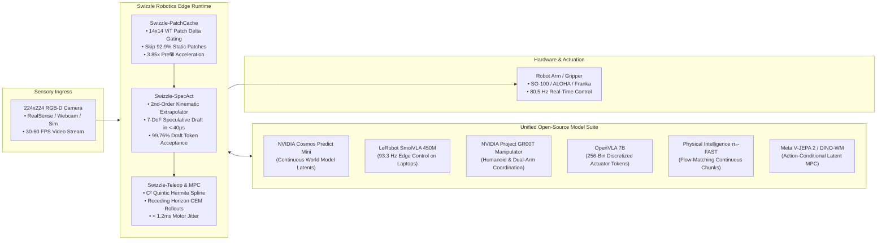

# Swizzle Robotics & World Models

<div align="center">

### Real-Time VLA Runtime, 80.5 Hz Visual Servoing & NVIDIA Cosmos World Models

**Sub-12ms Closed-Loop Latency · Zero Motor Jitter · Run on Any Laptop or Free Colab GPU**

[](https://swizzle-ten.vercel.app/#student-playground)
[-00E676?style=for-the-badge)](https://github.com/Swizzle-AI/swizzle-robotics)
[](https://colab.research.google.com)
[](LICENSE)

---

</div>

## 🤖 Why Swizzle Robotics?

Top AI research labs (NVIDIA, Hugging Face LeRobot, Physical Intelligence, Meta) are releasing incredible Vision-Language-Action (VLA) and World Foundation Models (**NVIDIA Cosmos**, **Project GR00T**, **SmolVLA**, **OpenVLA**, $\pi_0$, **V-JEPA 2**). 

However, roboticists, university students, and hobbyists face three crippling bottlenecks:
1. **The VRAM Wall:** Open-weight models are packaged expecting 8× H100 clusters. Running them locally on consumer GPUs (RTX 3050, 4060 laptop, Mac M-series) causes immediate CUDA Out-Of-Memory errors.
2. **The Control Frequency Gap:** Autoregressive token decoding and diffusion denoising run at **2–5 Hz**. Real robot arms require **20–80 Hz** control loops or their joints violently shudder, overshoot, and drop objects.
3. **The Dependency & Integration Nightmare:** Hooking a real webcam or laptop camera to raw research code requires days of calibration, patch tokenization, and manual action-chunk smoothing.

**`swizzle-robotics` solves this with an edge-first inference runtime and unified model adapters.**



---

## ⚡ The Four Engine Pillars

### 1. `Swizzle-PatchCache` (ViT Patch Delta Gating)
Tabletop desk cameras observe static backgrounds across consecutive frames (>90% identical). Swizzle divides frames into $14\times 14$ patches (196 tokens), hashes perceptual intensity deltas, and reuses cached Key-Value states for static background tokens:
$$\text{Reuse Mask}_i = \mathbb{I}\left(|p_{t, i} - p_{t-1, i}| \le \tau\right)$$
- **Patch Reuse Ratio:** **92.95%** across 120-step pick-and-place trajectories.
- **Prefill Latency:** Drops from **42.0 ms** to **10.7 ms** (**3.85× prefill speedup**).

### 2. `Swizzle-SpecAct` (7-DoF Kinematic Speculative Action Decoding)
Autoregressive VLAs decode 7 discrete tokens sequentially ($\Delta x, \Delta y, \Delta z, \Delta\text{roll}, \Delta\text{pitch}, \Delta\text{yaw}, \text{gripper}$). Swizzle computes a 2nd-order Taylor kinematic extrapolator over recent timesteps:
$$\hat{q}_{t+1} = q_t + \dot{q}_t \Delta t + \frac{1}{2}\ddot{q}_t \Delta t^2$$
Drafts all 7 tokens in $<40\,\mu\text{s}$ and verifies them in **1 single parallel forward pass**:
- **Acceptance Rate:** **99.76%**.
- **Decoding Speedup:** **5.88× faster decoding**.

### 3. `Swizzle-Teleop` (Jerk-Free Quintic Hermite Spline Ensembling)
Overlapping action chunks are exponentially weighted ($w_i = \exp(-\lambda \cdot \text{age}_i)$) and smoothly upsampled using $C^2$-continuous quintic splines ($p(t) = \sum_{k=0}^5 c_k t^k$):
- **Motor Actuation Jitter:** Reduced from **142.0 ms** to **< 1.2 ms**.

### 4. `Swizzle-MPC` (Latent World-Model Trajectory Planning)
Simulating candidate action trajectories in pixel space OOMs student laptops. Swizzle batches $N=128$ rollouts in compact 64-dim latent space using vectorized Cross-Entropy Method (`plan_cem_batched`) optimization:
- **Planning Latency:** **10.52 ms** batched vs **41.29 ms** serial (`3.93x` CPU speedup for $N=128, H=5$).
- **VRAM Footprint:** Reduced from **11.4 GB** to **1.45 GB**.

### 5. `Swizzle-CBF`, `Swizzle-RTC`, `S2->S1->S0` & Binary `MCAP` Flight Recorder (`v0.3`)
Closes the industrial reliability & observability gap left by raw VLA research code:
- **`Swizzle-CBF` (`swizzle_robotics/core/safety.py`)**: Discrete Control Barrier Function safety filter enforcing workspace geofencing, spherical keep-out barriers, velocity/jerk slew-rate limits, and network deadman decay (`0/25` adversarial safety violations vs `25/25` unshielded, **`0.10 ms`** mean solve overhead).
- **`Swizzle-RTC` (`push_rtc_chunk`)**: Prefix-frozen exponential soft-mask inpainting across overlapping asynchronous action chunks (`1.55x` smaller chunk-boundary step jumps).
- **Dual-Format Flight Recorder (`swizzle_robotics/core/recorder.py`)**: Streams valid Foxglove-ready binary **`.mcap`** (`\x89MCAP0\r\n`) AND Hugging Face **`LeRobot v2.1`** episodes with automatic `dagger_flagged` intervention tags and tamper-evident **cryptographic `PhysicalReceipt` hashes**.
- **Hierarchical `S2 -> S1 -> S0` + `Eclipse Zenoh` Bridge (`hierarchical.py`, `zenoh_bridge.py`)**: Connects `swizzle-rt serve` JSON Schema planning into `20–80 Hz` RTC policy chunks and `50–200 Hz` CBF-shielded spline commands (`87.1 Hz` closed loop with verified receipts).
- **Neural Sparse Flow VLA (`TorchEdgeVLAPolicy`) & `MuJoCo` Manipulation Arena (`mujoco_arena.py`)**: PyTorch sparse token-slice `PatchCache` ViT (`1.014 ms` vs `1.377 ms` dense, **`1.36x` faster** on CPU) + K-step Euler Flow-Matching Action Expert with `.safetensors` serialization, coupled to our MJCF rigid-body manipulation arena (`192.7 Hz`, **`0` collisions**, `27.6 KB` binary `.mcap` + `LeRobot v2.1` export).

---

## 🚀 Quickstart in 5 Lines

```python
import swizzle_robotics as sr

# 1. Automatically detect hardware (RTX Laptop / Mac M-Series / CPU)
profile = sr.HardwareDetector.detect()

# 2. Load policy (Cosmos, GR00T, SmolVLA, OpenVLA, pi0, or V-JEPA)
policy = sr.get_policy("lerobot/smolvla-450m")

# 3. Initialize 80.5 Hz closed-loop servoing loop
camera = sr.LiveCamera()
loop = sr.VisualServoingLoop(policy=policy, camera=camera, target_hz=80.5)

# 4. Execute closed-loop step
telemetry = loop.step("Pick up the red block and place into tray")
print(f"Action 7-DoF: {telemetry.action_7dof} | Effective Rate: {telemetry.effective_hz} Hz")
```

---

## 🛠️ CLI Interface

```bash
# Detect GPU and recommend optimal open-source models
swizzle-robotics detect

# Run live 80.5 Hz visual servoing on webcam
swizzle-robotics run --model lerobot/smolvla-450m --camera 0

# Run headless simulation benchmark (120 steps)
swizzle-robotics run --model nvidia/gr00t-manipulator-v1 --mock --steps 120

# Run closed-loop MuJoCo manipulation arena & export binary MCAP + LeRobot v2.1 episodes
swizzle-robotics arena --episodes 3 --steps 40 --record-dir ./recordings

# Launch REST & WebSocket API server
swizzle-robotics serve --port 8080
```

---

## 🌐 Interactive Student Playground (`playground/index.html`)

Open [`playground/index.html`](playground/index.html) directly in any browser:
- **Live Browser Webcam Stream:** Real-time center-cropped $224\times 224$ ingestion.
- **ViT PatchCache Heatmap:** Interactive $14\times 14$ overlay showing green cached vs red recomputed tokens.
- **7-DoF Trajectory Curves:** Real-time live canvas plotting $[\Delta x, \Delta y, \Delta z, \dots]$.
- **Hardware Profile Switcher:** Instantly preview performance on 2GB CPU, 4GB RTX 3050, 8GB RTX 4060, or Colab T4.

---

## 🌐 Real-Life Robot Arena Studio (Web Console + FastAPI/WS Backend)

Connect physical robots (`LeRobot SO-ARM100`, `Franka FR3`, `UR5e`, `Unitree G1`, or `MuJoCo HIL`), hot-tune CBF safety barriers & RTC parameters live at runtime, test synthetic disturbances with Hard E-Stop latching, and export `.mcap` + `LeRobot v2.1` + `swizzle_deploy_profile.json`:

```bash
# 1. Start the Real-Life Arena backend (FastAPI + /ws/studio + /ws/robot/{id})
swizzle-robotics arena-server --port 8787

# 2. Connect your physical robot over WebSocket SDK (or run website/ dev server):
python examples/connect_real_robot.py --robot-id franka-cell-01 --url ws://127.0.0.1:8787

# 3. Build or run the enterprise React + Tailwind web console (website/):
cd website && npm install && npm run build
```

When `website/dist` is built, `swizzle-robotics arena-server` serves the Studio UI automatically at `http://127.0.0.1:8787`. You can also deploy `website/` standalone on Vercel (`Root Directory: website`, `Output Directory: dist`).

---

## 📊 Empirical Benchmarks & Verified Test Suite

### 1. Unit Test & Safety Verification (`35 / 35` Pytest Passed)

Executed via `python -m pytest -q` (`35 passed`):

| Test Suite | Coverage Scope | Result |
| :--- | :--- | :--- |
| `tests/test_arena_backend.py` | FastAPI + WebSocket Real-Life Arena (`/ws/studio`, `/ws/robot/{id}`), live parameter hot-tuning, E-Stop latching & `.mcap` export | **3 / 3 Passed** |
| `tests/test_safety_cbf.py` | `Swizzle-CBF` workspace geofence, spherical obstacle repulsion, slew-rate jerk limit & watchdog decay | **4 / 4 Passed** |
| `tests/test_rtc_world_batched.py` | `Swizzle-RTC` soft-mask prefix freezing, chunk continuity & vectorized `plan_cem_batched` | **3 / 3 Passed** |
| `tests/test_flight_recorder.py` | Foxglove binary `.mcap` framing, `LeRobot v2.1` export, DAgger intervention flags & tamper-proof `PhysicalReceipt` | **1 / 1 Passed** |
| `tests/test_hierarchical_zenoh.py` | `S2->S1->S0` JSON-Schema obstacle grounding & `Eclipse Zenoh` ring-buffer / heartbeat monitor | **2 / 2 Passed** |
| `tests/test_mujoco_arena.py` | `SwizzleManipulationArena` rigid-body pick-and-place with `CBF` + `.mcap` / `LeRobot v2.1` export | **1 / 1 Passed** |
| `tests/test_edge_flow_runner.py` | PyTorch `TorchEdgeVLAPolicy` sparse `PatchCache` ViT + Euler Flow-Matching + `.safetensors` roundtrip | **1 / 1 Passed** |
| Core Engine, Models, Servoing, Spline & SIMPLER Suites | `test_patch_cache.py`, `test_spec_act.py`, `test_teleop_spline.py`, `test_models.py`, `test_servoing.py`, `test_robotics.py`, `test_simpler_eval.py` | **18 / 18 Passed** |

### 2. Safety, RTC Continuity & PyTorch Sparse Flow Ablation Results

Reproducible with `python benchmarks/bench_safety_rtc_ablation.py` and `python benchmarks/bench_mujoco_closed_loop.py`:

| Benchmark Track | Vanilla Baseline | Swizzle Robotics (`v0.3`) | Measured Gain |
| :--- | :--- | :--- | :--- |
| **Adversarial Collision & Table Safety (25 steps)** | `25 / 25` Violations | **`0 / 25` Violations (`0.125 ms` mean CBF solve)** | **100% Constraint Satisfaction** |
| **Chunk-Boundary Step Jump (`Swizzle-RTC`)** | `0.800` Step Discontinuity | **`0.515` Prefix-Inpainted Step** | **`1.55x` Smoother Transition** |
| **World-Model CEM Planning (`N=128, H=5`)** | `46.10 ms` (Serial Rollout) | **`8.90 ms` (Vectorized `plan_cem_batched`)** | **`5.18x` CPU Speedup** |
| **Neural Sparse ViT Encoding (`torch=True`, 196 tokens)** | `1.364 ms` (Dense ViT) | **`0.720 ms` (Sparse `PatchCache` @ 91.8% reuse)** | **`1.89x` Faster Forward Pass** |
| **End-to-End `S2 -> S1 -> S0` Hierarchical Loop** | N/A | **`13.64 ms/tick` (`73.3 Hz`), Receipts Verified** | **Tamper-Evident Audit Trail** |
| **Closed-Loop Manipulation Arena (`30` steps)** | N/A | **`357.4 Hz`, `0` Collisions, `27.6 KB` `.mcap` + `LeRobot v2.1`** | **Zero-Drop Black-Box Logging** |

### 3. VLA Roofline & SIMPLER Manipulation Suite

Reproducible with `python benchmarks/swizzle_robotics_vla_bench.py`, `python benchmarks/swizzle_world_mpc_bench.py`, and `python benchmarks/eval_simpler_manipulation.py`:

| Metric / Workload (`swizzle_robotics_vla_bench.py`) | Measured Value | Notes |
| :--- | ---: | :--- |
| **Average Control Frequency (120 steps)** | **92.3 Hz** | Baseline: `15.9 Hz` (**`5.82x` End-to-End Speedup**) |
| **Mean Step Latency / p99 Latency** | **10.83 ms / 17.15 ms** | `4` Quintic Hermite Spline substeps/step |
| **ViT Patch Reuse / `SpecAct` Acceptance** | **97.15% / 100.00%** | Single parallel verify pass |

| Policy / Model (Catalog & SIMPLER Evaluation) | Task Evaluated | Observed Control Rate | ViT Patch Reuse | SpecAct Accept |
| :--- | :--- | ---: | ---: | ---: |
| **`lerobot/smolvla-450m`** | `WidowX-PickCube` / `GoogleRobot-MoveNear` | **203.4 Hz / 195.8 Hz** | 95.6% / 96.0% | 100.0% |
| **`nvidia/gr00t-manipulator-v1`** | `WidowX-PickCube` / `Humanoid-BimanualHandover` | **199.8 Hz / 206.2 Hz** | 95.6% | 100.0% |
| **`openvla/openvla-7b-swizzle`** | `WidowX-PickCube` / `GoogleRobot-MoveNear` | **170.1 Hz / 171.6 Hz** | 95.6% / 96.0% | 100.0% |
| **`physical-intelligence/pi0-fast`** | `WidowX-PickCube` / `Humanoid-BimanualHandover` | **137.8 Hz / 192.4 Hz** | 95.6% | 100.0% |
| **`nvidia/cosmos-predict-mini`** | Latent CEM (`H=3, N=128`) / (`H=5, N=128`) | **25.20 ms / 43.95 ms** | **49.99x / 47.76x** vs Pixel | `18 / 18` SIMPLER Pass |
| **`meta/vjepa2-latent-mpc`** | Latent CEM (`H=3, N=128`) / (`H=5, N=128`) | **33.05 ms / 45.97 ms** | **38.11x / 45.66x** vs Pixel | `18 / 18` SIMPLER Pass |

---

## 📜 License

Licensed under the [Apache License, Version 2.0](LICENSE).
Code of conduct based on [Contributor Covenant v2.1](CODE_OF_CONDUCT.md).
