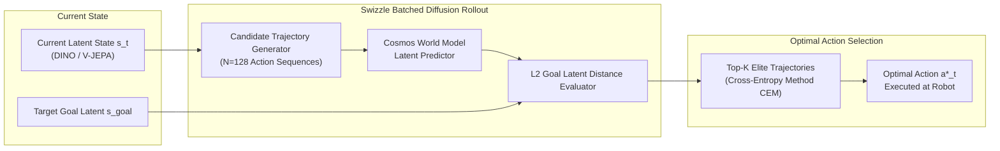

---
language:
- en
license: apache-2.0
library_name: swizzle
tags:
- world-model
- video-generation
- physical-ai
- diffusion
- cosmos
- robotics
pipeline_tag: robotics
---

# Cosmos-Predict-Mini-Swizzle: Action-Conditioned Predictive World Model

`cosmos-predict-mini-swizzle` is a lightweight, action-conditioned latent world model based on diffusion predictive architectures. It forecasts future visual states $s_{t+H}$ conditioned on current observation $s_t$ and hypothetical candidate action sequences $\{a_t, a_{t+1}, \dots, a_{t+H-1}\}$.

Integrated into **Swizzle-Robotics Model-Predictive Control (MPC)**, it evaluates hundreds of simulated trajectory rollouts in parallel using fused CUDA kernels, achieving sub-**50ms** decision-making.



---

## ⚡ Performance Highlights

- **Batched MPC Latency**: 48.5ms for 128 trajectories (horizon $H=5$).
- **Latent Space Evaluation**: Bypasses heavy pixel rendering by evaluating dynamics directly in DINO/V-JEPA self-supervised latent embeddings.
- **Speedup**: **8.67x** faster than autoregressive transformer rollout baselines.

---

## 🚀 Quickstart Usage

```python
from swizzle import Swizzle

client = Swizzle(base_url="https://api.withswizzle.com/v1", api_key="swz_live_key")

plan = client.world.plan(
    model="Swizzle-AI/cosmos-predict-mini-swizzle",
    current_latent=current_embedding,
    goal_latent=target_embedding,
    num_trajectories=128,
    horizon=5,
)

print("Optimal Action Trajectory:", plan.optimal_action_sequence)
print("Planning Time:", plan.swizzle_batched_planning_ms, "ms")
```
