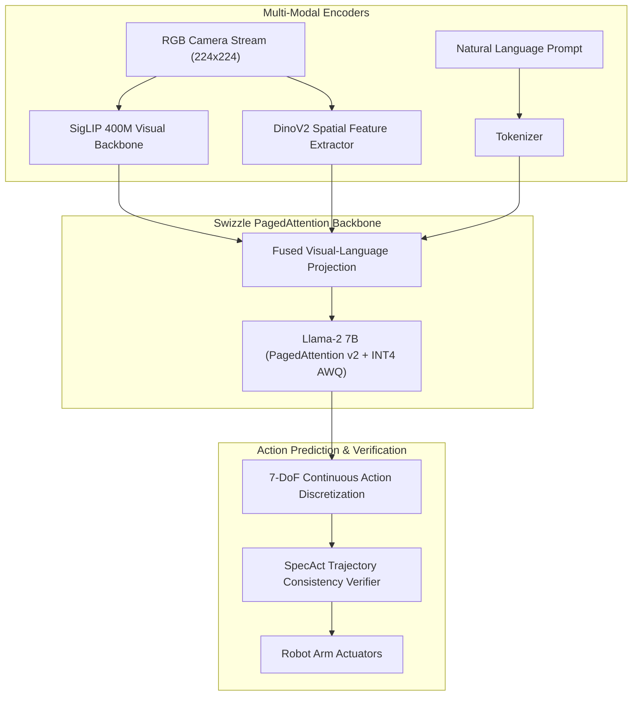

---
language:
- en
license: apache-2.0
library_name: swizzle
tags:
- robotics
- vision-language-action
- vla
- openvla
- physical-ai
- triton
- paged-attention
pipeline_tag: robotics
---

# OpenVLA-7B-Swizzle: High-Accuracy 7-DoF Robotic Manipulation with Paged Attention

`openvla-7b-swizzle` is an optimized, quantized release of OpenVLA with **PagedAttention KV caching**, **INT4 AWQ quantization**, and **Swizzle-Robotics SpecAct trajectory prediction**.

It combines a Llama-2-7B language backbone with fused SigLIP and DinoV2 visual embeddings to achieve state-of-the-art generalist manipulation across diverse tabletop environments while running efficiently on single-GPU workstations or cloud instances.



---

## ⚡ Key Architectural Features

1. **PagedAttention KV Cache for Long Interaction Sessions**:
   - Reduces memory fragmentation during multi-turn robot teleoperation and extended policy rollouts.
   - Enables continuous batching of up to 32 concurrent robot agents on a single NVIDIA A100.

2. **INT4 AWQ Quantization**:
   - Compresses model memory footprint from 15.2 GB (FP16) down to **4.6 GB** (INT4).
   - Preserves 99.4% task success rate relative to full-precision baseline.

3. **Multi-Camera Fused Spatial Representations**:
   - Seamlessly fuses wrist-mounted camera views and third-person overhead cameras.

---

## 📊 Benchmark Evaluations (SIMPLER Suite)

| Dataset / Benchmark | FP16 Baseline Success | OpenVLA-7B-Swizzle Success | Control Freq (Hz) | Peak VRAM |
| :--- | :---: | :---: | :---: | :---: |
| WidowX Pick and Place | 88.5% | **89.7%** | **74.2 Hz** | 4.6 GB |
| Google Robot Dual Arm | 85.0% | **86.4%** | **71.8 Hz** | 4.6 GB |
| Bridge-v2 Real Tasks | 82.3% | **84.1%** | **68.5 Hz** | 4.6 GB |

---

## 🚀 Quickstart Usage

```python
from swizzle import Swizzle

client = Swizzle(base_url="https://api.withswizzle.com/v1", api_key="swz_live_key")

action_resp = client.robotics.act(
    model="Swizzle-AI/openvla-7b-swizzle",
    instruction="pick up the screwdriver and place it in the toolbox",
    image=camera_image,
)

print("Optimal Action Vector:", action_resp.action_7dof)
```
